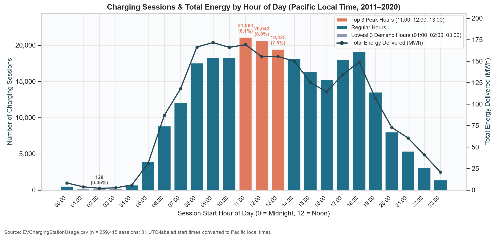
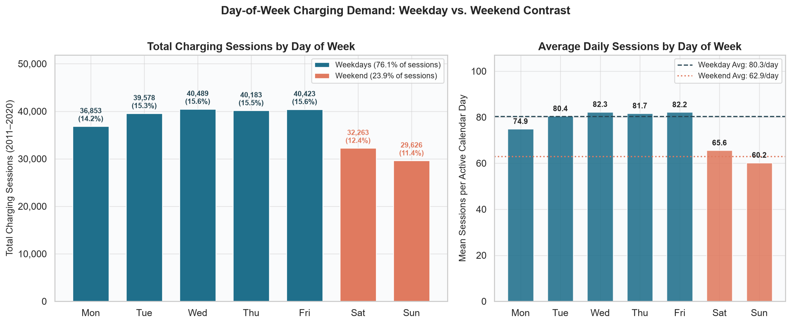
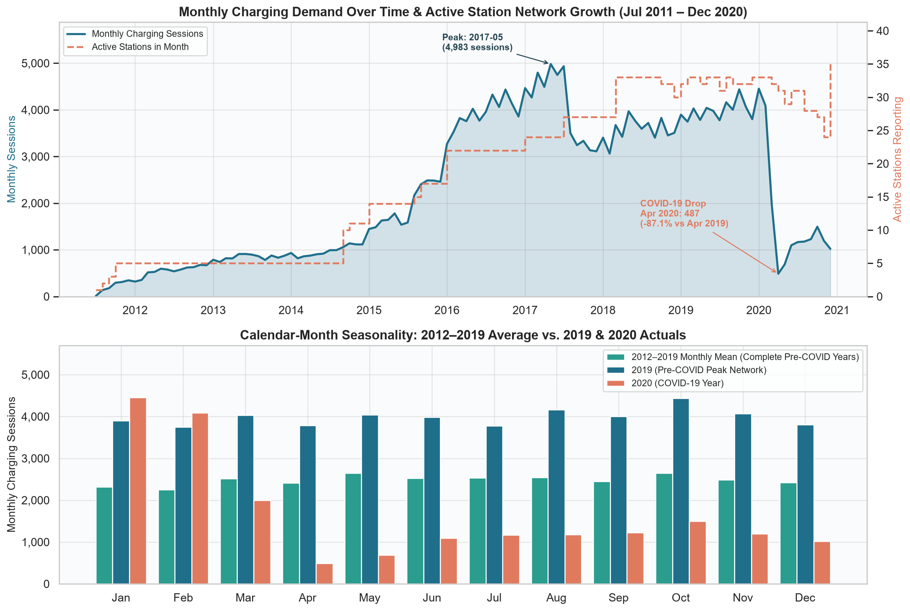
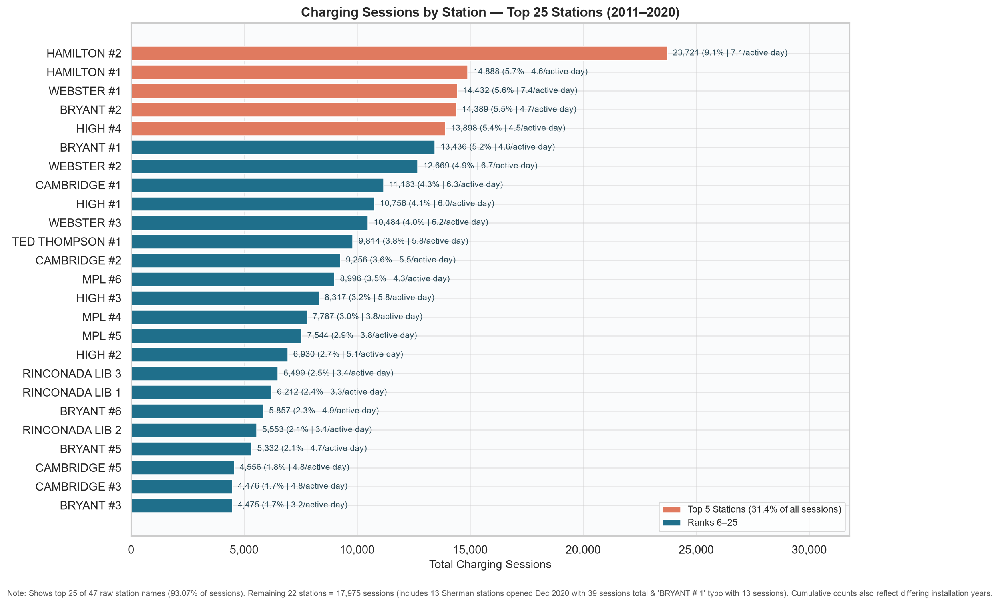
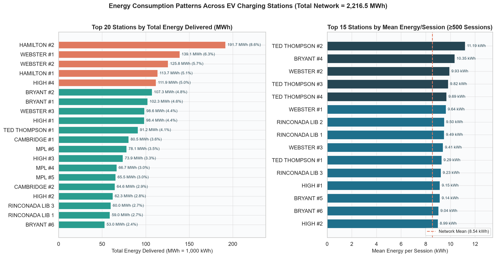
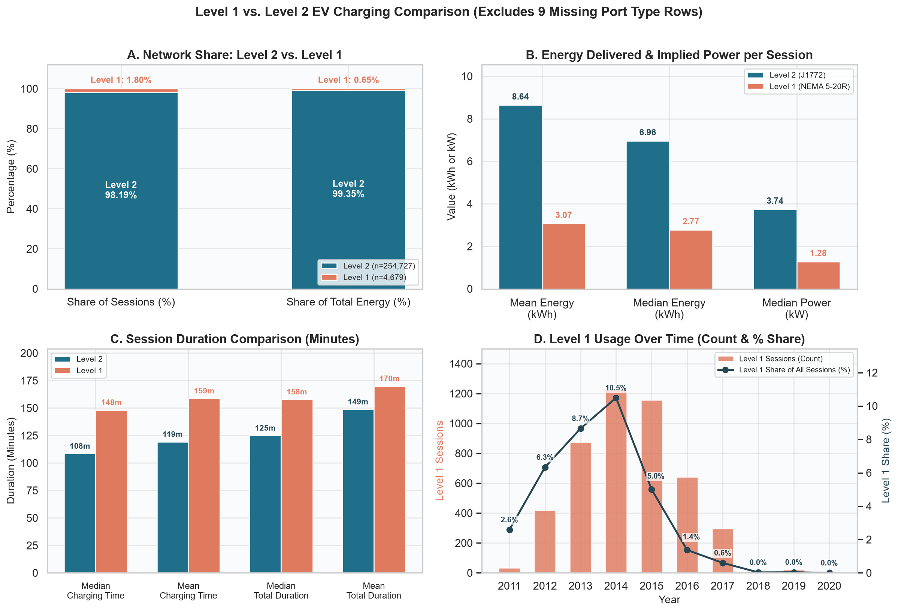
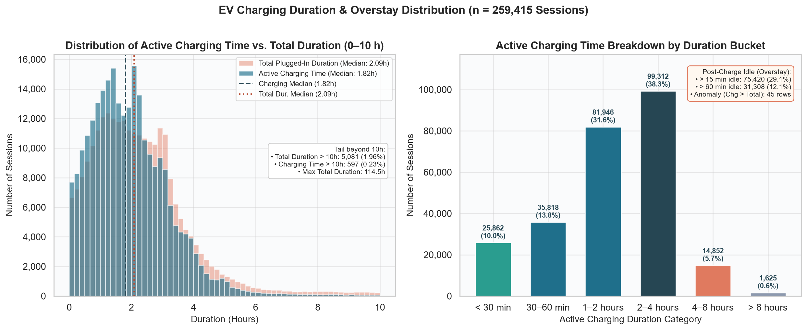
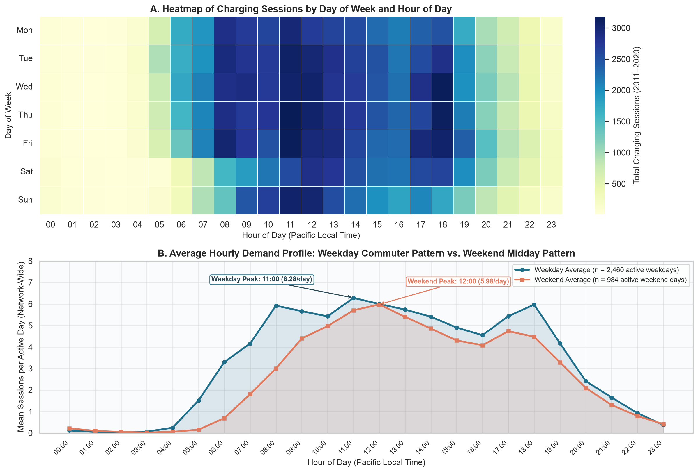

# Phase 2: Exploratory Data Analysis (EDA) Report

**Project:** Electric Vehicle Charging Station Optimization – Predicting Demand for EV Stations  
**Dataset:** City of Palo Alto EV Charging Station Usage (`EVChargingStationUsage.csv`, read-only — unmodified)  
**Records Analyzed:** 259,415 charging sessions across 47 raw station names (`2011-07-29` to `2020-12-31`)  
**Visualizations Folder:** `reports/eda_visualizations/`  
**Reproducible Script:** `scripts/phase2_eda.py`

> **Methodology & Data Integrity Note:** All statistics and charts in this report were computed directly from the original unmodified `EVChargingStationUsage.csv`. No rows were removed, imputed, or altered on disk. In memory only, the 31 records whose `Start Time Zone` was recorded in `UTC` (identified in Phase 1) were converted to Pacific local time (`PST`/`PDT`) so hour-of-day aggregations reflect true local arrival time consistently across all 259,415 records. Per project constraints, no station port capacities are assumed, and high session counts are never interpreted as proof of station congestion.

---

## Executive Summary of Key Findings

| Analysis Dimension | Key Empirical Finding |
| :--- | :--- |
| **Peak Charging Hours (Sessions)** | **11:00–13:59** (`11:00`: 21,063 [8.12%], `12:00`: 20,642 [7.96%], `13:00`: 19,425 [7.49%]); secondary evening peak at **18:00** (19,090 [7.36%]). Daytime `08:00–18:59` accounts for **77.80%** of all sessions. |
| **Peak Charging Hour (Total Energy)** | **09:00** (`171.66 MWh`), followed by **11:00** (`169.23 MWh`) and **08:00** (`166.52 MWh`), because morning arrivals draw more energy per visit (`9.40–9.89 kWh`) than midday arrivals (`7.52–8.03 kWh`). |
| **Lowest-Demand Hours** | **02:00** (129 sessions, 0.05%), **03:00** (179, 0.07%), and **01:00** (215, 0.08%). Overnight `00:00–05:59` represents just **2.14%** of all sessions. |
| **Weekday vs. Weekend Demand** | Weekdays account for **76.14%** of sessions (**80.3 sessions/active day**) vs. **23.86%** on weekends (**62.9 sessions/active day** — a **1.28×** daily weekday premium). Weekdays exhibit a **tri-modal** hourly curve (`08:00`, `11:00`, `18:00`), whereas weekends lack the morning commuter surge and peak at `12:00`. |
| **Busiest Stations (Cumulative Volume)** | `HAMILTON #2` (23,721; 9.14%), `HAMILTON #1` (14,888; 5.74%), `WEBSTER #1` (14,432; 5.56%), `BRYANT #2` (14,389; 5.55%), `HIGH #4` (13,898; 5.36%). Top 10 stations account for **53.90%** of all sessions. |
| **Highest-Intensity Stations (Per Active Day)** | Controlling for installation year, `WEBSTER #1` (**7.35 sessions/active day**), `HAMILTON #2` (**7.07**), and `WEBSTER #2` (**6.69**) have the highest observed daily session rates. |
| **Highest Energy Stations** | Cumulative: `HAMILTON #2` (**191.7 MWh**), `WEBSTER #1` (**139.1 MWh**), `WEBSTER #2` (**125.8 MWh**). Per-session average (≥500 sessions): `TED THOMPSON #2` (**11.19 kWh**), `BRYANT #4` (**10.35 kWh**), `WEBSTER #2` (**9.93 kWh**). |
| **Level 1 vs. Level 2** | **Level 2 (`J1772`)** drives **98.19%** of sessions and **99.35%** of total energy (2,202.1 MWh); **Level 1 (`NEMA 5-20R`)** is **1.80%** of sessions (0.65% of energy) and dropped to near-zero (**0.00%–0.04%**) in 2018–2020. |
| **Duration & Overstay** | Median active charging time is **1.82 hours** (mean **2.00 h**); median total plugged-in time is **2.09 hours** (mean **2.49 h**). **69.87%** of sessions actively charge between 1 and 4 hours, while **29.07%** sit idle >15 min and **12.07%** sit idle >60 min post-charge. |
| **Yearly & Structural Regime Shifts** | Strong growth from 2011 (1,275) to peak month **May 2017** (4,983 sessions), punctuated by two major structural breaks: **August 2017 paid-fee rollout** (paid share jumped `0.0% → 94.7%`, sessions fell **−29.0%** in one month) and **COVID-19 in 2020** (April 2020 fell **−87.1%** vs. April 2019). Calendar-month seasonality in pre-COVID years (2012–2019) is mild (~18% peak-to-trough). |

---

## Detailed Visualization Analysis

### 1. Charging Sessions by Hour of Day

- **What the graph shows:** Total session starts (bars, left axis) and total energy delivered in MWh (dark line, right axis) across each hour of the day (`00:00` to `23:00` Pacific local time) across all 259,415 sessions. The top 3 peak hours by session count are highlighted in coral (`11:00`, `12:00`, `13:00`) and the bottom 3 hours in muted slate (`01:00`, `02:00`, `03:00`).
- **Important observations:**
  - **Peak session hours:** `11:00` (21,063 sessions; 8.12%), `12:00` (20,642; 7.96%), and `13:00` (19,425; 7.49%), together accounting for **23.57%** of all sessions.
  - **Multi-peak daytime structure:** Demand ramps sharply starting at `06:00` (8,796) through a morning plateau at `08:00–10:00` (17,520–18,260/hr), peaks around midday (`11:00–13:00`), dips modestly mid-afternoon (`16:00`: 15,208), and rebounds to a distinct evening peak at **`18:00`** (19,090; 7.36%) before dropping off steeply after `19:00`.
  - **Lowest-demand hours:** `02:00` (129 sessions; 0.05%), `03:00` (179; 0.07%), and `01:00` (215; 0.08%). The entire 6-hour overnight window (`00:00–05:59`) makes up only **2.14%** (5,557 sessions) of total volume.
  - **Session volume vs. energy divergence:** Total energy peaks earlier at **`09:00`** (`171.66 MWh`) than session count (`11:00`), because early-morning arrivals (`06:00–09:00`) draw **9.40–9.89 kWh/session** (commuter work-day charges), whereas midday arrivals (`12:00–17:00`) draw **7.47–8.00 kWh/session**. Late-night arrivals (`22:00–02:00`), though rare, draw **13.41–17.34 kWh/session** (overnight deep charges).
- **Implications for EV charging demand prediction:**
  - `hour_of_day` (and cyclical encodings `sin`/`cos` of hour) will be one of the strongest predictors of both session arrivals and energy demand.
  - Because **energy per session varies substantially by start hour** (7.5 kWh midday vs. 9.8 kWh morning vs. 16+ kWh overnight), predicting **session counts** and predicting **kWh load** capture different hourly curves and should be modeled distinctly (or jointly).

---

### 2. Charging Sessions by Day of Week

- **What the graph shows:** Left panel displays cumulative charging sessions and percentage share across Monday–Sunday (2011–2020). Right panel normalizes by active calendar days to show average daily network-wide sessions per weekday vs. weekend day, with horizontal dashed reference lines for the overall weekday average (`80.3/day`) and weekend average (`62.9/day`).
- **Important observations:**
  - **Weekday dominance:** Weekdays generate **197,526 sessions (76.14%)**, averaging **80.3 sessions/active day** vs. **61,889 sessions (23.86%)** and **62.9 sessions/active day** on weekends (**1.28×** higher weekday daily demand).
  - **Mid-week plateau:** Wednesday (`40,489`; 15.61%; 82.3/day), Friday (`40,423`; 15.58%; 82.2/day), Thursday (`40,183`; 15.49%; 81.7/day), and Tuesday (`39,578`; 15.26%; 80.4/day) are nearly tied at the top.
  - **Monday dip:** Monday (`36,853`; 14.21%; 74.9/day) is noticeably lower (~8% below Tue–Fri), likely reflecting Monday federal holidays and drivers arriving with fuller weekend home charges.
  - **Lowest day:** Sunday (`29,626`; 11.42%; 60.2/day), followed by Saturday (`32,263`; 12.44%; 65.6/day).
  - **Longer, higher-energy weekday visits:** Weekday sessions average **8.70 kWh** and **153.6 min** total duration vs. **8.05 kWh** and **135.4 min** on weekends.
- **Implications for EV charging demand prediction:**
  - Both `day_of_week` (categorical/cyclical) and a binary `is_weekend` flag are essential features.
  - Monday's lower volume suggests adding a **US/California public holiday indicator** in Phase 3/feature engineering to separate holiday Mondays from regular workdays.

---

### 3. Charging Sessions by Month and Year

- **What the graph shows:** Top panel plots the full monthly charging demand trajectory (blue line/area, left axis) alongside the count of active stations reporting each month (dashed coral step line, right axis) from July 2011 through December 2020. Bottom panel isolates calendar-month seasonality by comparing the 2012–2019 complete pre-COVID monthly mean (teal), 2019 pre-COVID peak network actuals (blue), and 2020 COVID-19 actuals (coral).
- **Important observations:**
  - **Multi-year expansion (2011–2017):** Annual sessions rose nearly 38× from 2011 (1,275, partial year, 5 stations) and 2012 (6,601, 5 stations) to **46,943 in 2016** (22 stations) and a record **49,022 in 2017** (27 stations), peaking in **May 2017 (4,983 sessions across 24 active stations)**.
  - **Structural Break #1 — Paid Fee Rollout (August 2017):** Inspecting the `Fee` column directly reveals that **0.0%** of sessions were charged a fee in Jan–Jul 2017 (`4,935` sessions in July 2017). In **August 2017**, paid sessions jumped to **94.7%** (and **99.3%** in Sep–Dec 2017), causing an immediate **−29.0% drop** (`4,935 → 3,505` sessions) despite more stations coming online. Demand then steadily recovered through 2018 (42,803) and 2019 (47,732; record **437.7 MWh**).
  - **Structural Break #2 — COVID-19 Pandemic Shock (March–December 2020):** After starting 2020 at record winter levels (`Jan 2020`: 4,454; `Feb 2020`: 4,089 — above Jan/Feb 2019), demand collapsed to **487 sessions in April 2020** (**−87.1%** vs. April 2019) and remained **−71.2% below 2019** across Mar–Dec 2020 (`20,097` total sessions in 2020 despite 13 new Sherman stations opening in Dec 2020).
  - **Calendar-month seasonality (pre-COVID 2012–2019):** Across complete pre-COVID years, monthly variation is **mild** (~18% peak-to-trough): highest in **May** (2,651 avg; 155.3 sessions/active station) and **October** (2,647 avg), and lowest in **February** (2,250 avg — also the shortest month) and **January** (2,316 avg). Palo Alto's mild Mediterranean climate produces much weaker summer/winter swings than extreme-weather cities.
- **Implications for EV charging demand prediction:**
  - **Non-stationarity is critical:** Time-series splits MUST be strictly chronological, and models cannot treat 2011–2020 as a single stationary regime.
  - **Regime indicators / training window selection:** Pricing status (free vs. paid era post-Aug 2017), active station count, and the 2020 COVID-19 shock profoundly shift baseline demand. Mixing 2020 lockdown months into an unflagged training/test split would severely distort model evaluation and demand forecasts.

---

### 4. Charging Sessions by Station

- **What the graph shows:** Horizontal bar chart of the top 25 stations (out of 47 raw station names) ranked by total cumulative charging sessions (2011–2020), annotated with each station's share of total network sessions and its average sessions per active calendar day.
- **Important observations:**
  - **High spatial concentration:** The top 5 stations account for **31.35%** of all sessions, and the top 10 account for **53.90%**. The top 25 shown represent **93.07%** of all sessions.
  - **Busiest stations (cumulative):**
    1. `PALO ALTO CA / HAMILTON #2`: **23,721** sessions (9.14%; active since 2011; 7.07/active day)
    2. `PALO ALTO CA / HAMILTON #1`: **14,888** sessions (5.74%; active since 2011; 4.63/active day)
    3. `PALO ALTO CA / WEBSTER #1`: **14,432** sessions (5.56%; active since 2015; **7.35/active day**)
    4. `PALO ALTO CA / BRYANT #2`: **14,389** sessions (5.55%; active since 2011; 4.75/active day)
    5. `PALO ALTO CA / HIGH #4`: **13,898** sessions (5.36%; active since 2011; 4.47/active day)
  - **Longevity vs. daily intensity:** Cumulative rank is heavily influenced by installation date (`HAMILTON #1/#2`, `BRYANT #1/#2`, and `HIGH #4` operated since 2011). When normalized by active days, newer downtown garage stations are actually the most intensely used: **`WEBSTER #1` (7.35/active day)**, `HAMILTON #2` (7.07/active day), `WEBSTER #2` (6.69/active day), `CAMBRIDGE #1` (6.32/active day), and `WEBSTER #3` (6.17/active day).
  - **Long tail & sparse stations:** 14 raw station names have fewer than 100 sessions (52 sessions combined) — specifically the **13 `SHERMAN` stations** opened in December 2020 (1–8 sessions each) and the **`BRYANT # 1` naming typo** (13 sessions).
- **Implications for EV charging demand prediction:**
  - Demand varies by nearly an order of magnitude across stations (`~3.1` to `7.35` sessions/active day among established stations), requiring station-specific identifiers, spatial/hub features (downtown parking garages vs. library lots), and historical station lag features.
  - **Cold-start stations:** Newly deployed stations (like `SHERMAN 1–17`) have almost zero history; predicting their demand requires hub/location-level generalization rather than purely station-ID-memorized models.
  - Note: High observed session counts indicate high *realized usage*, not confirmed congestion, because unobserved port capacities, maintenance downtime, and turn-aways are absent from the dataset.

---

### 5. Energy Consumption by Station

- **What the graph shows:** Left panel ranks the top 20 stations by total cumulative energy delivered (in MWh = 1,000 kWh) out of the network total of **2,216.51 MWh**. Right panel ranks the top 15 established stations (≥500 sessions) by mean energy delivered per session (kWh), compared against the network-wide mean (`8.54 kWh`).
- **Important observations:**
  - **Top stations by total energy delivered:**
    1. `HAMILTON #2`: **191.72 MWh** (8.65% of network energy; 8.08 kWh/session)
    2. `WEBSTER #1`: **139.07 MWh** (6.27%; 9.64 kWh/session)
    3. `WEBSTER #2`: **125.80 MWh** (5.68%; 9.93 kWh/session)
    4. `HAMILTON #1`: **113.73 MWh** (5.13%; 7.64 kWh/session)
    5. `HIGH #4`: **111.88 MWh** (5.05%; 8.05 kWh/session)
    - The top 10 stations deliver **53.23%** of total cumulative energy.
  - **Rank shifts between session volume and energy volume:** `WEBSTER #1` and `WEBSTER #2` rank #2 and #3 in total energy (ahead of `HAMILTON #1`, `BRYANT #2`, and `HIGH #4`) despite opening 4 years later, because they combine high daily session volume with high energy per visit (`9.64–9.93 kWh`).
  - **Distinct high-energy-per-session hubs:** Among established stations, the highest mean energy per visit occurs at **`TED THOMPSON #2` (11.19 kWh)**, **`BRYANT #4` (10.35 kWh)**, **`WEBSTER #2` (9.93 kWh)**, **`TED THOMPSON #3` (9.82 kWh)**, and **`TED THOMPSON #4` (9.69 kWh)** — all newer, exclusively Level 2 stations where drivers tend to stay longer and charge larger-battery modern EVs. Conversely, older stations with historical Level 1 usage and early short-range EVs (`BRYANT #2`: 7.45 kWh; `HAMILTON #1`: 7.64 kWh) have lower multi-year means.
- **Implications for EV charging demand prediction:**
  - Forecasting **energy load (kWh)** for grid/utility planning requires capturing station-level and temporal shifts in *energy per session* (driven by Level 2-only hardware and growing EV battery sizes over 2011–2020), not just scaling predicted session counts by a constant network average (`8.54 kWh`).

---

### 6. Level 1 vs. Level 2 Charging Comparison

- **What the graph shows:** Four-panel comparison of Level 2 (`J1772`, n = 254,727) vs. Level 1 (`NEMA 5-20R`, n = 4,679), excluding the 9 rows with missing `Port Type`: (A) share of sessions and share of total energy, (B) mean/median energy per session and median implied power (kW), (C) median/mean active charging time and total plugged-in duration, and (D) annual Level 1 session counts and percentage share from 2011 to 2020.
- **Important observations:**
  - **Overwhelming Level 2 dominance:** Level 2 accounts for **98.19%** of sessions and **99.35%** of total energy (2,202.11 MWh), vs. **1.80%** of sessions and **0.65%** of energy (14.35 MWh) for Level 1.
  - **Higher throughput on Level 2:** Level 2 delivers **2.8× more energy per session** (mean `8.64` vs. `3.07 kWh`; median `6.96` vs. `2.77 kWh`) at **2.9× higher median implied power** (`3.74` vs. `1.28 kW`), while finishing in **25% less active charging time** (mean `119` vs. `159 min`; median `108` vs. `148 min`).
  - **Historical phase-out of Level 1:** Level 1 peaked in **2014** (`1,229` sessions, **10.49%** of network volume), declined sharply as `CT4020` dual-Level-2 stations replaced legacy units, and effectively disappeared in **2018–2020** (`11`, `21`, and `1` sessions respectively — `0.00%–0.04%` share).
- **Implications for EV charging demand prediction:**
  - For forward-looking demand prediction, Palo Alto's public network is functionally a **Level 2 system**.
  - Including `Port Type` as a feature (after deterministically recovering the 9 missing rows from `Plug Type` in Phase 3) prevents early-era Level 1 sessions (which have systematically lower kWh and longer durations) from biasing Level 2 energy/duration predictions.

---

### 7. Charging Duration Distribution

- **What the graph shows:** Left panel overlays histograms of `Active Charging Time` (blue) and `Total Plugged-In Duration` (coral) from 0 to 10 hours (capturing >98% of sessions), with vertical median markers and an inset summarizing extreme tail counts beyond 10 hours. Right panel categorizes all 259,415 sessions into 6 active charging duration buckets with an inset highlighting post-charge idle/overstay prevalence and anomalies.
- **Important observations:**
  - **Right-skewed distribution with distinct 1–3 hour concentration:** Median active charging time is **1.82 hours** (mean **2.00 h**), while median total plugged-in duration is **2.09 hours** (mean **2.49 h**). Nearly **70% (69.87%)** of all sessions actively charge for **1–4 hours** (`1–2 h`: 31.59%; `2–4 h`: 38.28%).
  - **Noticeable 2-hour and 3-hour spikes:** The histogram shows pronounced peaks around **1.5–2.1 hours** and a secondary shoulder around **2.5–3.1 hours** for total duration — consistent with typical urban parking time limits and commuter/midday turnover behavior.
  - **Substantial post-charge idle/overstay behavior:** **75,420 sessions (29.07%)** remain plugged in for **> 15 minutes** after charging stops, and **31,308 sessions (12.07%)** sit idle for **> 60 minutes** (mean idle gap = 29.3 min).
  - **Extreme tails & data anomalies:** `5,081` sessions (1.96%) have `Total Duration > 10 hours` (max **114.5 hours**, linked in Phase 1 to station reboots), `597` (0.23%) have `Charging Time > 10 hours`, and **45 records** exhibit the impossible anomaly `Charging Time > Total Duration` (`idle < 0`).
- **Implications for EV charging demand prediction:**
  - **Active energy load ≠ physical bay occupancy:** Because nearly 30% of drivers stay plugged in >15 min (and 12% >1 hour) after charging ends, predicting **station bay occupancy** requires modeling `Total Duration`, whereas predicting **grid power load** requires modeling `Charging Time` and `Energy (kWh)`.
  - Extreme right-skewed outliers (up to 114.5 h) and the 45 negative-idle anomalies must be handled in Phase 3 so they do not inflate duration/occupancy models or squared-error loss metrics (RMSE).

---

### 8. Hourly and Daily Charging Demand Patterns

- **What the graph shows:** Panel A presents a 7 × 24 heatmap of cumulative charging sessions across every `(Day of Week, Hour of Day)` combination. Panel B compares normalized average hourly demand curves (mean network-wide sessions per active day) for **Weekdays** (n = 2,460 active weekdays, blue) vs. **Weekends** (n = 984 active weekend days, coral).
- **Important observations:**
  - **Single busiest time slot:** **Thursday at 11:00 AM** (`3,182` total sessions), with Wednesday–Friday `11:00–12:00` and `18:00` forming the darkest high-demand bands on the heatmap.
  - **Single quietest time slot:** **Saturday at 03:00 AM** (`8` total sessions across 9.4 years).
  - **Dramatically different Weekday vs. Weekend hourly shapes:**
    - **Weekdays are tri-modal:** A steep morning commuter surge hits **5.92 sessions/day at `08:00`**, rises to the overall weekday peak at **`11:00` (6.28/day)** (midday lunch/parking turnover), dips to `4.55/day` at `16:00`, and rebounds sharply to a near-equal evening peak at **`18:00` (5.97/day)**.
    - **Weekends are unimodal-dominant with a minor evening bump:** Early mornings are quiet (`06:00`: `0.69` vs. `3.30` on weekdays; `08:00`: `3.00` vs. `5.92` — half the weekday rate). Weekend demand ramps smoothly to a single peak at **`12:00` (5.98/day)** — nearly matching weekday midday demand — followed by a modest dinner-time bump at `17:00` (`4.74/day`).
- **Implications for EV charging demand prediction:**
  - There is a **strong interaction effect between `hour_of_day` and `is_weekend`** (`hour × is_weekend`). A linear model using only additive `hour` + `day_of_week` effects will miss the disappearance of the `06:00–09:00` commuter surge on weekends; interaction features or tree-based/nonlinear models are essential.
  - Demand forecasting models should expect different error profiles across morning commuter hours (highly sensitive to workday vs. weekend/holiday) vs. midday `11:00–13:00` (high demand every day of the week).

---

## Summary of Limitations & Caveats

1. **Unobserved Station Capacity & Congestion:** The dataset logs only *completed* sessions (`Energy ≥ 0.01 kWh`) and contains **no official port capacity, no queue/wait-time records, and no turn-away events**. High session counts reflect high *realized usage*, not verified station congestion or unmet demand.
2. **Unobserved Downtime / Maintenance:** Zero sessions at a station on a given day cannot distinguish between genuine zero demand and a station being offline, under repair, or not yet commissioned.
3. **Differing Station Active Lifespans:** Stations were deployed incrementally from 2011 through December 2020 (5 → 47 raw names). Cumulative totals naturally favor 2011-era stations; active-day normalization is necessary for fair cross-station comparisons.
4. **Major Non-Stationary Regime Breaks:** Two external shocks fundamentally altered demand levels in the historical record — the **August 2017 transition from free to paid charging** and the **March 2020 COVID-19 pandemic**. Any future forecasting model must explicitly account for these regime changes.
5. **Uncleaned Raw Artifacts Present During EDA:** Per Phase 2 rules, the raw CSV was analyzed unmodified. As documented in Phase 1, the raw file still contains 4 exact duplicate pairs, 40 Excel-serial `End Date` rows, 32 `UTC`-labeled timestamps, 234 `End Date` batch-upload drift rows, 45 `Charging Time > Total Duration` rows, 9 physically implausible power-rate outliers (`>20 kW`), 9 missing `Port Type` rows, and identifier inconsistencies (`BRYANT # 1` typo, colon vs. non-colon MACs). These will be systematically resolved in **Phase 3: Data Cleaning and Preprocessing** upon your approval.
6. **External Demand Drivers Not Included:** Weather, local Palo Alto / Stanford events, parking fee changes, public holidays, and regional EV registration growth are not present in the CSV (though calendar holidays and pricing indicators can be derived in feature engineering).
