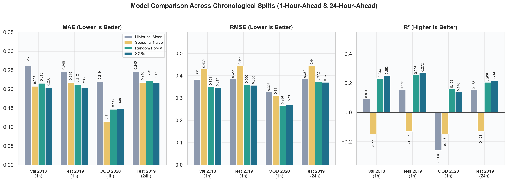
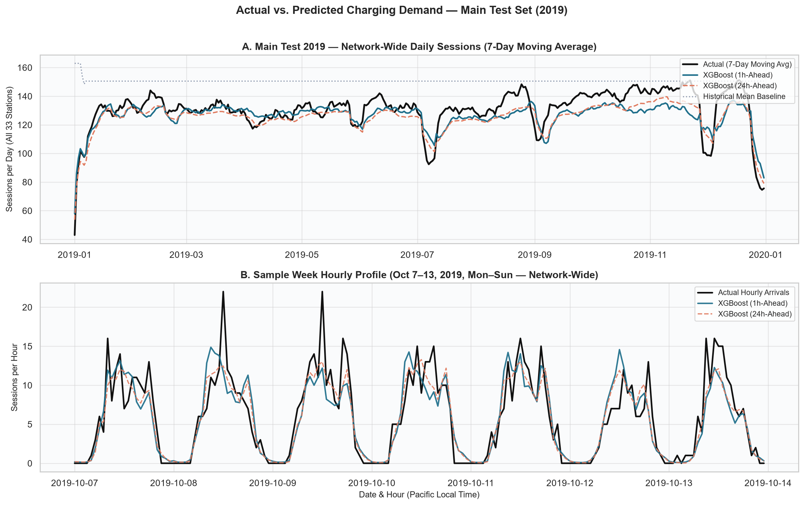
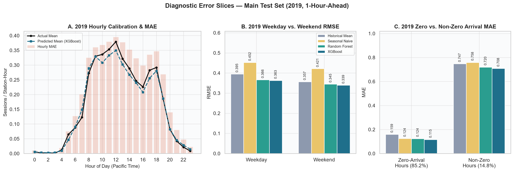
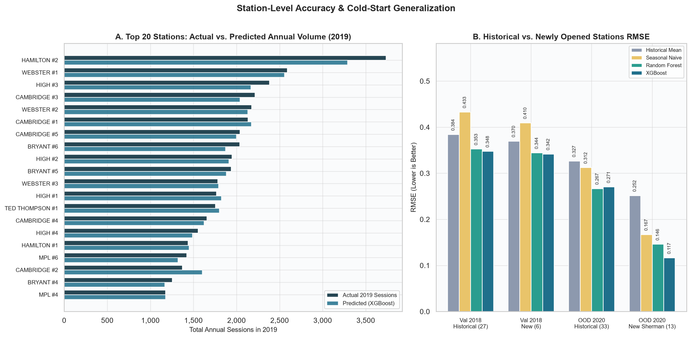
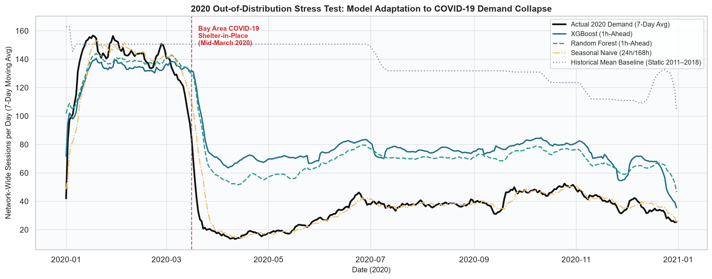
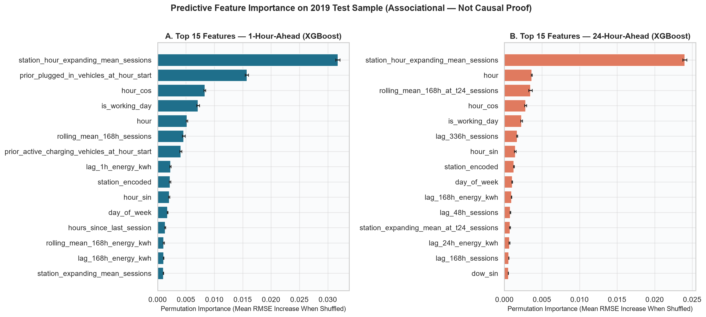

# Phase 5: Model Training and Evaluation Report

**Project:** Electric Vehicle Charging Station Optimization – Predicting Demand for EV Stations  
**Input Dataset (Unmodified):** `dataset/processed/ev_charging_hourly_features.csv` (1,533,050 station-hours × 44 columns)  
**Saved Models & Metadata:** `models/` (`best_model_1h.joblib`, `best_model_24h.joblib`, per-model `.joblib` artifacts, `training_metadata.json`)  
**Scripts:** `ml/common.py`, `ml/train_model.py`, `ml/evaluate_model.py`, `ml/predict_demand.py`  
**Evaluation Charts:** `reports/model_evaluation/` (`01`–`06`)

> **Upstream Integrity & Anti-Leakage Verification:** SHA-256 checksums confirmed that the raw CSV (`EVChargingStationUsage.csv`), Phase 3 cleaned CSV (`ev_charging_cleaned.csv`), and Phase 4 feature CSV (`ev_charging_hourly_features.csv`) were never modified. No rows were randomly shuffled. All preprocessors, encoders, imputers, and hyperparameters were fitted strictly on training/validation periods prior to final evaluation on untouched 2019 and 2020 data.

---

## 1. Primary Prediction Task & Metric Definitions

### Prediction Objective
- **Primary Task (1-Hour-Ahead):** Predict `sessions_count` — the number of EV charging sessions **arriving** at a given `station_id` during the upcoming Pacific Time clock hour `[t, t + 1h)`, using only information available strictly prior to `t`.
- **Important Clarification:** `sessions_count` measures **hourly arrival flow** (new drivers plugging in), **not** simultaneous occupancy or occupied port counts.
- **Secondary Task (24-Hour-Ahead):** Predict `sessions_count` at hour `t` using **only** information available at least 24 hours earlier (`≤ t − 24h`) plus known calendar features for hour `t`.

### Evaluation Metrics in Plain Language
- **MAE (Mean Absolute Error):** Average absolute difference between predicted and actual arrivals per station-hour. For example, an MAE of `0.20` means predictions are off by `0.20` sessions per station-hour on average.
- **RMSE (Root Mean Squared Error):** Like MAE, but squares errors before averaging, so large misses (such as failing to anticipate a 2–4 arrival peak burst) are penalized much more heavily than small `0.05` errors on quiet hours.
- **R² (Coefficient of Determination):** Share of total variance in hourly arrivals explained by the model compared to predicting a flat constant average (`R² = 0` equals a flat mean; `R² < 0` is worse than a flat mean; higher is better).
- **Why R² Alone Is Not Enough Here:** In 2019, **85.25%** of all station-hours have `0` arrivals (and **92.85%** in 2020). Because discrete hourly arrivals at a single 2-port pedestal (`0, 1, 2, ...`) have substantial irreducible Poisson randomness (even if a station's true expected arrival rate is `0.40/hr`, actual realizations are randomly `0` or `1`), theoretical single-station hourly R² is naturally bounded well below `1.0`. Similarly, a naive model that predicts `0` on most hours can appear to have a low **MAE** while failing badly on **RMSE** and **R²** (as demonstrated by Seasonal Naive below). We therefore evaluate **MAE, RMSE, R², total volume bias %, and slice-level errors together**.

---

## 2. Chronological Data Split & Anti-Leakage Protocol

| Split | Calendar Period | Station-Hours | Actual Sessions | Active Stations | Historical vs. New Stations | Role |
| :--- | :--- | --: | --: | --: | :--- | :--- |
| **Training** | `2011–2017` | 707,668 | 148,780 | 27 | 27 initial stations | Initial model fitting & preprocessor fitting |
| **Validation** | `2018` | 277,536 | 42,803 | 33 | **27 historical** + **6 newly opened** (`CAMBRIDGE #3–5`, `TED THOMPSON #2–4`) | Hyperparameter tuning & model selection |
| **Final Retrain** | `2011–2018` | 985,204 | 191,583 | 33 | All 33 active through 2018 | Final refit after winner selection (zero peeking at 2019) |
| **Main Test** | `2019` | 289,080 | 47,731 | 33 | **33 historical** (0 new) | Primary untouched out-of-sample benchmark |
| **OOD Stress Test** | `2020` | 258,766 | 20,097 | 46 | **33 historical** + **13 newly opened** (`SHERMAN 1–17`, Dec 2020) | COVID-19 demand collapse & cold-start stress test |

### How Historical Features Avoid Leakage During Validation & Testing
- **Rolling 1-Hour-Ahead Evaluation (`39` features):** To predict hour `t`, the model uses only deterministic calendar/regime features (`hour`, `day_of_week`, `is_working_day`, `month`, cyclical `sin`/`cos`, `is_paid_era`), lags and rolling windows computed strictly on completed past hours `≤ t − 1h`, expanding station averages computed strictly on `≤ t − 1h`, and real-time pre-hour occupancy snapshots observed at `t:00:00` (`start < t < end`). Previous actual hourly demand enters rolling features only *after* that hour has finished and would genuinely be observed in production.
- **24-Hour-Ahead Evaluation (`30` features):** Strictly removes all `< 24h` information (`lag_1h/2h/3h`, `prior_plugged_in_vehicles_at_hour_start`, `hours_since_last_session`, and `t − 1`-anchored rolling windows), replacing them with `≤ t − 24h` lags (`lag_24h`, `lag_48h`, `lag_168h`, `lag_336h`) and rolling/expanding windows ending at `t − 24h`. Verified via an automated **adversarial perturbation proof** in `ml/train_model.py` (mutating targets across `[t* − 23 .. end]` by `+9,999` produced zero bit-level change in any 24h-ahead feature at `t*`).
- **Training-Only Preprocessing:** `TabularPreprocessor` fits ordinal `station_id` encoding (mapping unseen stations to `-1`) and median imputation strictly on the training split (`2011–2017` during validation; `2011–2018` for final evaluation). Raw `year` was intentionally excluded so tree models do not split on non-repeating calendar years; `is_paid_era`, `station_age_days`, and causal rolling means capture structural demand shifts instead. All model predictions are clipped at `≥ 0.0`.

---

## 3. Models Compared & Validation 2018 Tuning Results

All 4 model families were trained on `2011–2017` and tuned strictly on `Validation 2018`.

### 3.1 Hyperparameter Selection Summary (Validation 2018)

| Model Family | Tuning Search Performed on `2011–2017 → 2018 Val` | Best Selected Configuration |
| :--- | :--- | :--- |
| **1. Historical Mean Baseline** | Mean by `(station_id, hour, is_weekend)` fitted on training split only, with fallback to `(hour, is_weekend)` mean for unseen stations *(global flat mean also tracked as reference)* | Hierarchical `(station_id, hour, is_weekend)` mean |
| **2. Seasonal Naive Baseline** | Grid search over `w_24 ∈ {0.0, 0.25, 0.50, 0.75, 1.0}` blending `w_24 * lag_24h + (1 − w_24) * lag_168h` (RMSE ranged from `0.5025` at pure 24h to `0.4297` at 50/50 blend) | `w_24 = 0.50`, `w_168 = 0.50` |
| **3. Random Forest Regressor** | 4 regularized configs (`max_depth ∈ {12, 16, 20}`, `min_samples_leaf ∈ {30, 50, 60}`, `max_features ∈ {0.5, 'sqrt'}`, `max_samples = 0.35`, `n_estimators = 120`) | `max_depth=16`, `min_samples_leaf=30`, `max_features=0.5`, `max_samples=0.35` *(retrained with `n_estimators=150` on 2011–2018)* |
| **4. XGBoost Regressor** | 6 configs testing both `reg:squarederror` and `count:poisson` (`max_depth ∈ {5, 6, 8}`, `lr ∈ {0.03, 0.04, 0.05}`, `min_child_weight ∈ {30, 40, 60}`, `reg_lambda ∈ {2.0, 5.0}`, `early_stopping_rounds=40`) | **1h-ahead:** `reg:squarederror`, `max_depth=8`, `lr=0.03`, `min_child_weight=60`, `subsample=0.8`, `colsample_bytree=0.75`, `reg_lambda=5.0`, `n_estimators=448` **24h-ahead:** `reg:squarederror`, `max_depth=6`, `lr=0.04`, `min_child_weight=40`, `subsample=0.8`, `colsample_bytree=0.8`, `reg_lambda=5.0`, `n_estimators=386` |

> **Objective Trade-Off Note (`reg:squarederror` vs. `count:poisson`):** On Validation 2018 (1h-ahead), `count:poisson` (`max_depth=8`) achieved slightly lower MAE (`0.1975` vs. `0.2028`), but introduced a `−6.02%` aggregate volume under-prediction bias and higher RMSE (`0.3478` vs. `0.3469`, R² `0.2489` vs. `0.2528`). `reg:squarederror` won on primary RMSE, R², and aggregate volume calibration (`+1.79%` bias).

### 3.2 Validation 2018 Performance (Overall + Historical vs. Newly Opened Stations)

| Model (1-Hour-Ahead) | Overall MAE | Overall RMSE | Overall R² | Volume Bias (%) | Historical 27 Stations RMSE | New 6 Stations RMSE |
| :--- | --: | --: | --: | --: | --: | --: |
| *Global Constant Mean (Ref)* | *0.30586* | *0.40525* | *−0.01948* | *+36.32%* | *0.40897* | *0.38310* |
| **Historical Mean Baseline** | 0.26104 | 0.38206 | 0.09384 | +42.67% | 0.38413 | 0.36989 |
| **Seasonal Naive (50/50)** | 0.20742 | 0.42969 | −0.14614 | +0.04% | 0.43307 | 0.40964 |
| **Random Forest** | 0.21500 | 0.35148 | 0.23308 | +9.51% | 0.35268 | 0.34450 |
| **XGBoost (Selected Winner)** | **0.20275** | **0.34693** | **0.25282** | **+1.79%** | **0.34780** | **0.34190** |

- **Validation Selection Decision:** **XGBoost Regressor** achieved the best Validation 2018 score on **every single metric** (MAE, RMSE, R², historical stations, and newly opened 2018 stations) for both 1-hour-ahead and 24-hour-ahead (`Val RMSE = 0.35897`, `R² = 0.20005`). All 4 models were then retrained on `2011–2018` (`985,204` station-hours) and evaluated on untouched 2019 and 2020 data.

---

## 4. Final Evaluation Results — Main Test (2019) & OOD Stress Test (2020)

### 4.1 Primary Experiment (1-Hour-Ahead) — Main Test 2019 (Untouched, n = 289,080, 33 Historical Stations)

| Model | MAE ↓ | RMSE ↓ | R² ↑ | Actual Total Sessions | Predicted Total Sessions | Volume Bias (%) |
| :--- | --: | --: | --: | --: | --: | --: |
| *Global Constant Mean (Ref)* | *0.30219* | *0.41887* | *−0.00493* | *47,731* | *56,215* | *+17.77%* |
| **Historical Mean Baseline** | 0.24545 | 0.38452 | 0.15312 | 47,731 | 54,949 | +15.12% |
| **Seasonal Naive (50/50)** | 0.21764 | 0.44379 | −0.12806 | 47,731 | 47,708 | −0.05% |
| **Random Forest** | 0.21151 | 0.36036 | 0.25621 | 47,731 | 47,554 | −0.37% |
| **XGBoost (Selected Winner)** | **0.20293** | **0.35643** | **0.27232** | **47,731** | **46,092** | **−3.43%** |

- **Key Result (2019 Main Test):** **XGBoost wins cleanly across all three core metrics**, reducing RMSE by **−7.3%** and MAE by **−17.3%** relative to the Historical Mean Baseline, reducing RMSE by **−19.7%** relative to Seasonal Naive, and outperforming Random Forest on MAE (`0.2029` vs. `0.2115`), RMSE (`0.3564` vs. `0.3604`), and R² (`0.2723` vs. `0.2562`). Note that Random Forest achieved slightly tighter aggregate volume calibration (`−0.37%` vs. `−3.43%`).

### 4.2 Detailed Error Slices — Main Test 2019 (1-Hour-Ahead)

| Evaluation Slice | Slice Size (n) | Historical Mean (MAE / RMSE) | Seasonal Naive (MAE / RMSE) | Random Forest (MAE / RMSE) | XGBoost (MAE / RMSE / R²) |
| :--- | --: | --: | --: | --: | --: |
| **Zero-Arrival Hours (`y = 0`)** | 246,430 (85.2%) | 0.1586 / 0.2355 | 0.1241 / 0.3069 | 0.1236 / 0.2033 | **0.1154 / 0.2014** / — |
| **Non-Zero Hours (`y ≥ 1`)** | 42,650 (14.8%) | 0.7472 / 0.8256 | 0.7583 / 0.8892 | 0.7197 / 0.8008 | **0.7085 / 0.7917** / — |
| **Weekdays (Mon–Fri)** | 206,712 | 0.2600 / 0.3951 | 0.2251 / 0.4524 | 0.2190 / 0.3664 | **0.2110 / 0.3631** / 0.2815 |
| **Weekends (Sat–Sun)** | 82,368 | 0.2091 / 0.3566 | 0.1990 / 0.4214 | 0.1927 / 0.3447 | **0.1827 / 0.3391** / 0.2393 |

- **Zero vs. Non-Zero Behavior:** XGBoost achieves the lowest MAE and RMSE on **both** zero-arrival hours (`MAE = 0.1154`) and non-zero hours (`MAE = 0.7085`). Notice why non-zero MAE is ~`0.71`: because single-station arrivals are stochastic `0/1` events with typical expected rates of `0.25–0.45` during peak hours, an unbiased conditional expectation `E[y|x] ≈ 0.35` naturally incurs `0.35` error when `0` arrives and `0.65` error when `1` arrives!
- **Hourly Calibration:** As shown in Chart 4 Panel A, XGBoost's predicted mean hourly arrival rate tracks the actual 2019 hourly curve tightly across all 24 hours — near `0.003` at `02:00–03:00` (MAE `< 0.01`), capturing the morning ramp (`08:00–09:00`), midday peak (`12:00`: actual `0.380` vs. predicted `0.350`), afternoon dip (`16:00`), and evening peak (`18:00`: actual `0.292` vs. predicted `0.281`).
- **Weekday vs. Weekend:** XGBoost explains a higher share of variance on weekdays (`R² = 0.2815`, `RMSE = 0.3631`) than weekends (`R² = 0.2393`, `RMSE = 0.3391`), reflecting more regular weekday commuter schedules, while absolute error is lower on weekends due to lower overall arrival volume.

### 4.3 Station-Level Performance (2019 Main Test)

- **Highest-Volume 2019 Stations (XGBoost 1h-Ahead):**
  - `PALO ALTO CA / HAMILTON #2`: Actual `3,735` vs. Predicted `3,287` (`MAE = 0.351`, `RMSE = 0.518`, **`R² = 0.353`**)
  - `PALO ALTO CA / WEBSTER #1`: Actual `2,589` vs. Predicted `2,555` (`MAE = 0.292`, `RMSE = 0.439`, **`R² = 0.331`**)
  - `PALO ALTO CA / HIGH #3`: Actual `2,380` vs. Predicted `2,165` (`MAE = 0.304`, `RMSE = 0.455`, `R² = 0.230`)
  - `PALO ALTO CA / CAMBRIDGE #3`: Actual `2,212` vs. Predicted `2,038` (`MAE = 0.280`, `RMSE = 0.443`, `R² = 0.271`)
  - `PALO ALTO CA / WEBSTER #2`: Actual `2,174` vs. Predicted `2,129` (`MAE = 0.267`, `RMSE = 0.417`, **`R² = 0.308`**)
- **Very Sparse Stations (`MPL #1/#2/#3`, only `17–46` sessions all year):** Achieve ultra-low absolute errors (`MAE = 0.009–0.014`, `RMSE = 0.045–0.073`), but slightly negative single-station `R²` (`−0.02` to `−0.07`) because isolated rare arrivals are nearly impossible to time to the exact hour. Conversely, busy hubs (`HAMILTON #2`, `WEBSTER #1/#2`) have higher raw RMSE (higher arrival variance) but the strongest `R²` (`0.31–0.35`).

---

### 4.4 Out-of-Distribution Stress Test — 2020 (COVID-19 Shock & 13 New Stations, n = 258,766)

| Model (1-Hour-Ahead) | Overall MAE | Overall RMSE | Overall R² | Volume Bias (%) | Historical 33 Stations (RMSE / R²) | New 13 Sherman Stations (MAE / RMSE / R²) |
| :--- | --: | --: | --: | --: | --: | --: |
| *Global Constant Mean (Ref)* | *0.24430* | *0.31324* | *−0.16148* | *+150.38%* | — | — |
| **Historical Mean Baseline** | 0.21919 | 0.32626 | −0.26005 | +151.06% | 0.32681 / −0.2565 | 0.2013 / 0.2517 / −2.5282 |
| **Seasonal Naive (50/50)** | **0.11375** | 0.31145 | −0.14827 | **+0.76%** | 0.31237 / −0.1480 | 0.0447 / 0.1672 / −0.5564 |
| **Random Forest** | 0.14671 | **0.26614** | **0.16157** | +48.47% | **0.26691 / 0.1619** | 0.0818 / 0.1460 / −0.1873 |
| **XGBoost** | 0.14826 | 0.26960 | 0.13960 | +55.44% | 0.27051 / 0.1391 | **0.0432 / 0.1167 / +0.2420** |

- **Critical Stress-Test Findings:**
  1. **Static baselines break completely under regime shift:** `Historical Mean` over-predicts 2020 demand by **+151.1%** (`R² = −0.260`) because it stays anchored to 2011–2018 demand after the mid-March 2020 shelter-in-place orders.
  2. **ML models adapt partially via causal rolling lags, but still carry pre-COVID upward bias:** Both Random Forest (`+48.5%` volume bias, `R² = +0.162`) and XGBoost (`+55.4%` bias, `R² = +0.140`) immediately cut predictions by ~50% in late March 2020, maintaining positive R² throughout the shock — yet both still over-predict because their long-horizon expanding means and tree leaves never saw an −87% collapse in 2011–2018 training data.
  3. **Honest RF vs. XGBoost nuance under extreme shift:** On 2020 OOD (1h-ahead) across the 33 historical stations, **Random Forest** slightly edges out 1h XGBoost (`RMSE 0.2669` vs. `0.2705`), likely because bagged shallower/smoother Random Forest splits are less sensitive to deep interaction shifts than `max_depth=8` XGBoost.
  4. **Cold-start superiority of XGBoost on the 13 newly opened Sherman stations:** On the 13 completely unseen Dec-2020 Sherman stations (`n = 2,132` hours, `39` actual sessions), **XGBoost is the ONLY model with positive R² (`+0.2420`, `RMSE = 0.1167`, `MAE = 0.0432`)**, dramatically beating Random Forest (`−0.1873`) and Historical Mean (`−2.5282`), because XGBoost natively handles missing warm-up lags (`NaN`) rather than substituting training-period station medians!

---

## 5. Secondary Experiment: 24-Hour-Ahead Demand Prediction

Trained and evaluated using the exact same chronological splits (`2011–2017 → 2018 Val → retrain 2011–2018 → 2019 Test & 2020 OOD`) with strictly `≤ t − 24h` causal features (`30` features; zero `< 24h` information).

| Model (24-Hour-Ahead) | Val 2018 RMSE / R² | Main Test 2019 MAE | Main Test 2019 RMSE | Main Test 2019 R² | OOD 2020 MAE | OOD 2020 RMSE | OOD 2020 R² |
| :--- | --: | --: | --: | --: | --: | --: | --: |
| **Historical Mean Baseline** | 0.38206 / 0.0938 | 0.24545 | 0.38452 | 0.15312 | 0.21919 | 0.32626 | −0.26005 |
| **Seasonal Naive (50/50)** | 0.42969 / −0.1461 | 0.21764 | 0.44379 | −0.12806 | **0.11375** | 0.31145 | −0.14827 |
| **Random Forest (24h)** | 0.36097 / 0.1911 | 0.22265 | 0.37234 | 0.20590 | 0.14038 | 0.26711 | 0.15541 |
| **XGBoost (24h Winner)** | **0.35897 / 0.2001** | **0.21689** | **0.37044** | **0.21400** | 0.13492 | **0.26608** | **0.16192** |

### 1-Hour-Ahead vs. 24-Hour-Ahead Comparison
- **Value of Real-Time Short-Horizon Features (2019 Test):** Adding `< 24h` features (`prior_plugged_in_vehicles_at_hour_start`, `prior_active_charging_vehicles_at_hour_start`, `lag_1h/2h/3h`, `hours_since_last_session`, and recent 24h rolling demand) improves XGBoost on 2019 Test from `RMSE = 0.37044 → 0.35643` (**−3.8%**), `MAE = 0.21689 → 0.20293` (**−6.4%**), and `R² = 0.2140 → 0.2723` (**+5.8 percentage points**).
- **24h-Ahead Practical Utility & OOD Robustness:** Even without any real-time `< 24h` telemetry, 24h-ahead XGBoost still beats both baselines substantially on 2019 Test (`R² = 0.214` vs. `0.153`) — and remarkably achieved the **lowest 2020 OOD RMSE (`0.26608`) and highest OOD R² (`0.16192`) of all models tested** (its shallower `max_depth=6` trees and reliance on 7-day rolling levels generalized more robustly during the COVID-19 shift, with only `+28.0%` bias vs. `+55.4%` for deeper 1h XGBoost!).

---

## 6. Model Interpretation & Feature Importance

> **Causation Caveat:** Feature importance measures how strongly shuffling a feature degrades predictive accuracy (RMSE) on held-out 2019 data. **It reflects predictive association within the model, not proof of causal mechanisms.**

### Top Predictive Drivers (Permutation RMSE Increase on 2019 Test Sample, n = 60,000)

| Rank | 1-Hour-Ahead (XGBoost) | Perm. RMSE Δ | Gain % | 24-Hour-Ahead (XGBoost) | Perm. RMSE Δ | Gain % |
| :-: | :--- | --: | --: | :--- | --: | --: |
| 1 | `station_hour_expanding_mean_sessions` | +0.03177 | 13.7% | `station_hour_expanding_mean_sessions` | +0.02400 | 26.3% |
| 2 | `prior_plugged_in_vehicles_at_hour_start` | +0.01572 | 5.6% | `hour` | +0.00364 | 3.5% |
| 3 | `hour_cos` | +0.00832 | 3.6% | `rolling_mean_168h_at_t24_sessions` | +0.00347 | 13.9% |
| 4 | `is_working_day` | +0.00712 | 7.2% | `hour_cos` | +0.00282 | 7.9% |
| 5 | `hour` | +0.00517 | 2.5% | `is_working_day` | +0.00228 | 7.4% |
| 6 | `rolling_mean_168h_sessions` | +0.00460 | 5.8% | `lag_336h_sessions` | +0.00170 | 3.2% |
| 7 | `prior_active_charging_vehicles_at_hour_start` | +0.00407 | 7.0% | `hour_sin` | +0.00145 | 2.0% |
| 8 | `lag_1h_energy_kwh` | +0.00226 | 3.9% | `station_encoded` | +0.00126 | 0.9% |

### Substantive Interpretation of Feature Groups
1. **Station × Hour History (`station_hour_expanding_mean_sessions` — #1 in both horizons):** Captures each station's evolving baseline demand at a specific clock hour without peeking at future data, making it by far the single strongest anchor for demand forecasts.
2. **Pre-Hour Physical & Active Occupancy (`prior_plugged_in_vehicles_at_hour_start` #2, `prior_active_charging_vehicles_at_hour_start` #7 in 1h-ahead):** Accounts for the bulk of the accuracy jump from 24h-ahead to 1h-ahead. Knowing how many vehicles are already plugged in vs. actively drawing power at `t:00:00` strongly informs whether ports are currently occupied/saturated or actively turning over.
3. **Time of Day (`hour_cos`, `hour`, `hour_sin`):** Captures the sharp daytime arrival ramp (`07:00–19:00`) versus near-zero overnight arrivals (`01:00–04:00`).
4. **Working Day vs. Weekend/Holiday (`is_working_day` #4/#5, `day_of_week`):** Notably, our holiday-aware `is_working_day` feature ranked far higher than raw `is_weekend`, confirming that federal holiday Mondays behave more like weekends than workdays.
5. **Recent Demand Level (`rolling_mean_168h_sessions`, `lag_1h_energy_kwh`, `hours_since_last_session`, `lag_336h_sessions`):** Tracks short- and medium-term momentum, allowing models to adjust dynamically when a station's usage rises, dips, or experiences quiet/offline spells.
6. **Month (`month`, `month_sin`, `month_cos`):** Contributed modest predictive value (consistent with Phase 2's finding of mild calendar-month seasonality in Palo Alto's Mediterranean climate).

---

## 7. Selected Model, Limitations & Conclusions

### Selected Best-Performing Model
- **Selected Model (Both 1-Hour-Ahead and 24-Hour-Ahead): `XGBoost Regressor`** (saved as `models/best_model_1h.joblib` and `models/best_model_24h.joblib`).
- **Reason for Selection:**
  1. Won **Validation 2018** across MAE, RMSE, R², historical stations, and newly opened stations (without peeking at 2019).
  2. Confirmed #1 on untouched **Main Test 2019** across MAE (`0.20293`), RMSE (`0.35643`), and R² (`0.27232`) — and #1 across all error slices (zero hours, non-zero hours, weekdays, weekends).
  3. Demonstrated vastly superior cold-start generalization on the 13 newly opened Sherman stations in 2020 (`R² = +0.242` vs. negative R² for all other models) and fastest retraining latency (~50s vs. 156–501s for Random Forest).
  4. For **24-hour-ahead** planning, `XGBoost` (`max_depth=6`) won on **every single split** — Validation 2018, Main Test 2019, and OOD 2020 (`RMSE = 0.26608`, `R² = 0.16192`).

### Key Limitations
1. **Irreducible Hourly Count Stochasticity:** Single-station hourly arrivals are discrete, 85%-zero count events (`0, 1, 2, ...`). Expected arrival rate predictions (`0.25–0.45`) are well-calibrated in aggregate and hourly profiles, but individual station-hour predictions cannot deterministically predict exact discrete arrivals.
2. **Severe Structural Shift Requires Periodic Retraining:** As shown in 2020 OOD (`+48%` to `+55%` bias for 1h models), static models trained on pre-pandemic data cannot fully eliminate bias during an unprecedented −87% shock; a production system should schedule regular rolling retraining or online bias recalibration (and consider slightly shallower `max_depth=6` trees for OOD stability).
3. **Missing Exogenous Variables:** Weather, local Palo Alto/Stanford events, parking rule adjustments, and station maintenance status are absent from the source dataset.
4. **No Assumed Station Capacity:** Predictions represent expected **hourly session arrivals**, not occupancy utilization percentages.
